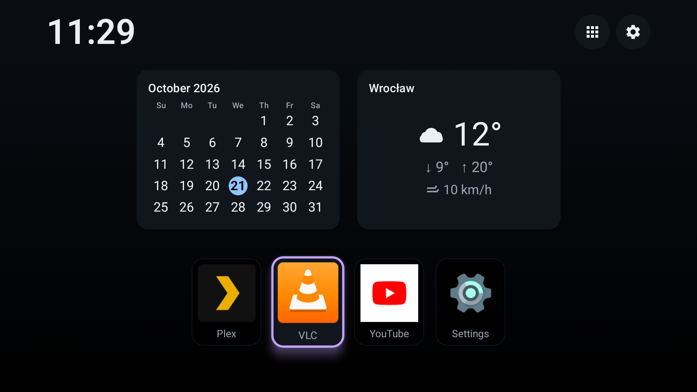
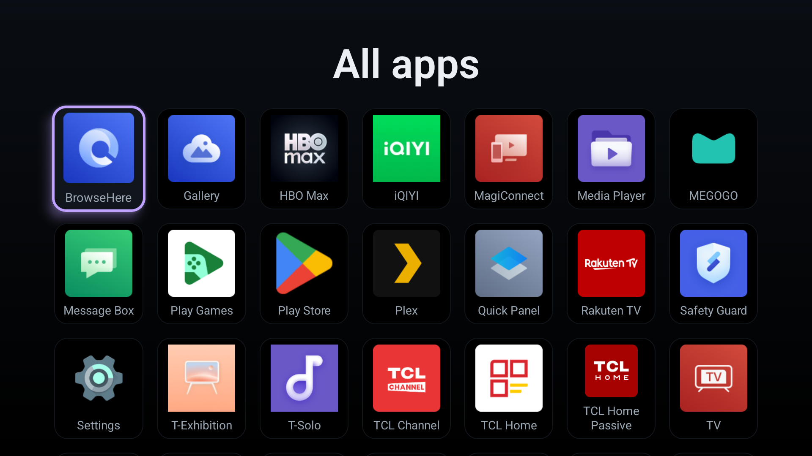
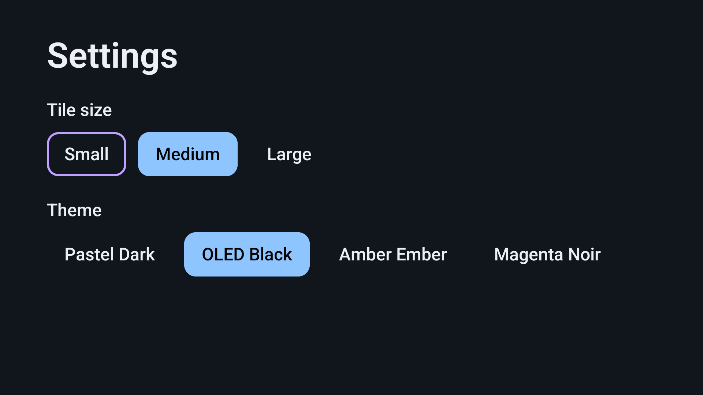

# NexaTV

**A fast, private, D-pad-first launcher for Android TV.**

Live product page: **https://viacheslavmelnichenko.github.io/NexaTV/**

## What it is

NexaTV is a working custom Home launcher for a TCL Google TV (Android TV OS 14).
It replaces the stock Home with a cleaner, faster, remote-first experience: a
focusable app grid, favorites, and glanceable widgets. It is offline-first with
no ads, accounts, or tracking, and runs light — idle memory is about 48.6 MB PSS
on the TCL. Built with Kotlin and Jetpack Compose for TV, and verified on the
real device.

## Features

- **App grid** — installed apps enumerated via `LauncherApps` across profiles
  (ADR-0004, no `QUERY_ALL_PACKAGES`); D-pad navigation, launch on **OK**.
- **Live app list** — apps appear and disappear as they are installed or removed
  (`LauncherApps.Callback`).
- **States** — Loading, Empty, and launch-error handling.
- **Favorites** — pin / unpin / reorder (built; final on-device visual check still
  pending).
- **Screens** — Home plus a dedicated **All apps** grid.
- **Home widgets** — clock, calendar, and weather (ADR-0010).
- **Theming** — four dark themes (Pastel Dark, OLED Black, Amber Ember, Magenta
  Noir) and three tile sizes (Small / Medium / Large), persisted and applied live.
- **Persistence** — settings and favorites stored via Proto DataStore (ADR-0008).
- **Design System** — semantic `NexaColorScheme`, focusable `AppTile`,
  `SectionHeader`, and a debug-only component gallery.

## Adaptive background preview

The `codex/adaptive-background` branch adds an optional river-city landscape with 16 time/weather
variants, smooth transitions, blur/dimming controls and optional subtle rain/snow. Existing regular
installations keep their theme background until enabled in Settings → Background.

**NexaTV Preview** is a separate app with separate settings/favorites. It opens from the TV app list
and does not claim HOME or include the accessibility override. Download the APK artifact from the
branch's **Preview APK** Actions run, or build `./gradlew :app:assemblePreview` with JDK 17 / SDK 34.
See [installation and device checks](docs/testing/ADAPTIVE-BACKGROUND-PREVIEW.md),
[architecture](docs/adr/ADR-0013-adaptive-backgrounds.md) and
[artwork provenance](docs/design/BACKGROUND-ARTWORK.md). Real-TV performance verification is pending.

## Screenshots

*All apps: the full grid of installed applications.*

*Settings: tile size and the four-theme switcher.*

## How it becomes HOME

This TCL firmware blocks third-party apps from taking the normal `ROLE_HOME`
(ADR-0006). NexaTV instead becomes Home through a reversible accessibility
override (`NexaOverrideService`, ADR-0007). The stock launcher is never disabled,
and the change can be undone at any time. Verified on the real TCL.

## Build & tech

- **Stack** — Kotlin + Jetpack Compose for TV, `minSdk`/`targetSdk` API 34,
  `armeabi-v7a` (32-bit).
- **CI** (`.github/workflows/ci.yml`) — assemble, Android Lint, unit tests,
  detekt, ABI assert, APK-size budget, and gitleaks secret scan.
- **Release** (`.github/workflows/release.yml`, ADR-0003) — a tag-driven pipeline
  builds, signs, verifies, and publishes a GitHub Release. Validated end-to-end
  with the real signing key; no public release is cut yet (next is `v0.1.0`).
- Architecture decisions live in [`docs/adr/`](docs/adr/).

## Docs

| Document | Purpose |
|----------|---------|
| [CHANGELOG.md](CHANGELOG.md) | Release notes and change history. |
| [docs/adr/](docs/adr/) | Architecture Decision Records. |
| [docs/product/PRD.md](docs/product/PRD.md) | Product requirements. |
| [docs/design/DESIGN-SYSTEM.md](docs/design/DESIGN-SYSTEM.md) | Design system and tokens. |
| [docs/technical/ADB.md](docs/technical/ADB.md) | ADB reference. |
| [docs/technical/ANDROID-TV.md](docs/technical/ANDROID-TV.md) | Android TV device and launcher notes. |
| [docs/testing/TEST-PLAN.md](docs/testing/TEST-PLAN.md) | Test plan. |
| [project/MILESTONES.md](project/MILESTONES.md) | Milestones. |
| [project/BACKLOG.md](project/BACKLOG.md) | Backlog. |

## License

Apache License 2.0 — see [`LICENSE`](LICENSE) and [`NOTICE`](NOTICE).
