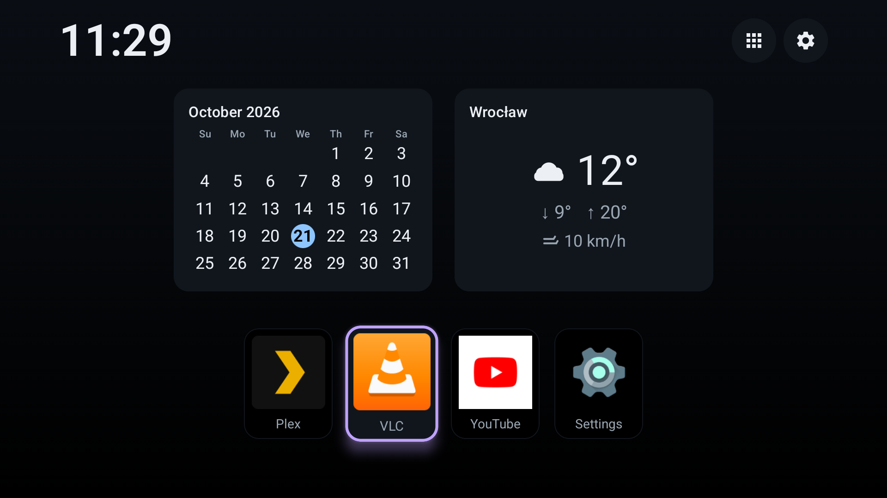
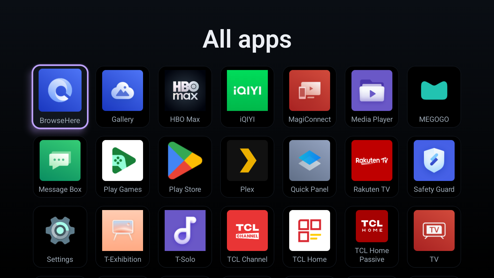
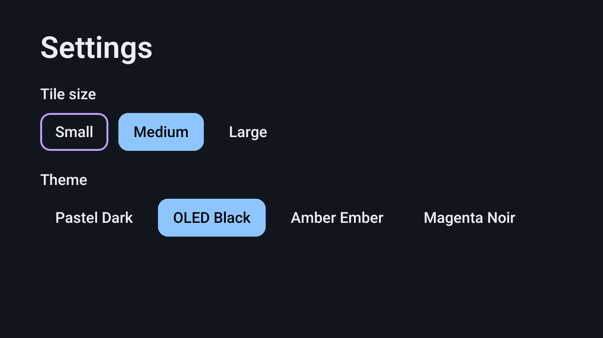

# NexaTV

**A fast, private, D-pad-first launcher for Android TV.**

Live product page: **https://viacheslavmelnichenko.github.io/NexaTV/**

## What it is

NexaTV is a working custom Home launcher for a TCL Google TV (Android TV OS 14).
It replaces the stock Home with a cleaner, faster, remote-first experience: a
focusable app grid, favorites, and glanceable widgets. It is offline-first with
no ads, accounts, or tracking, and runs light — idle memory is about 48.6 MB PSS
on the TCL. Built with Kotlin and Jetpack Compose for TV, and verified on the
real device.

## Features

- **App grid** — installed apps enumerated via `LauncherApps` across profiles
  (ADR-0004, no `QUERY_ALL_PACKAGES`); D-pad navigation, launch on **OK**.
- **Live app list** — apps appear and disappear as they are installed or removed
  (`LauncherApps.Callback`).
- **States** — Loading, Empty, and launch-error handling.
- **Favorites** — pin / unpin / reorder from a long-press OK context menu.
- **Screens** — Home plus a dedicated **All apps** grid.
- **Home widgets** — clock, calendar, and weather (ADR-0010).
- **Theming** — four dark themes (Pastel Dark, OLED Black, Amber Ember, Magenta
  Noir) and three tile sizes (Small / Medium / Large), persisted and applied live.
- **Adaptive backgrounds** — optional river-city landscape that follows time of day
  and weather, with blur/dimming and optional rain/snow (ADR-0013, opt-in under
  Settings → Background).
- **Persistence** — settings and favorites stored via Proto DataStore (ADR-0008).
- **Design System** — semantic `NexaColorScheme`, focusable `AppTile`,
  `SectionHeader`, and a debug-only component gallery.

## Preview app

**NexaTV Preview** is a separate app (`.preview` package) with its own settings and favorites. It opens from
the TV app list, does not claim HOME and has no accessibility override, so new visuals can be tried
without touching the installed launcher. Builds come from the **Preview APK** workflow (`codex/**`
branches, and prerelease `vX.Y.Z-preview.N` tags). See
[installation and device checks](docs/testing/ADAPTIVE-BACKGROUND-PREVIEW.md),
[ADR-0013](docs/adr/ADR-0013-adaptive-backgrounds.md) and
[artwork provenance](docs/design/BACKGROUND-ARTWORK.md).

## Screenshots

*All apps: the full grid of installed applications.*

*Settings: tile size and the four-theme switcher.*

## How it becomes HOME

This TCL firmware blocks third-party apps from taking the normal `ROLE_HOME`
(ADR-0006). NexaTV instead becomes Home through a reversible accessibility
override (`NexaOverrideService`, ADR-0007). The stock launcher is never disabled,
and the change can be undone at any time. Verified on the real TCL.

## Build & tech

- **Stack** — Kotlin + Jetpack Compose for TV, `minSdk`/`targetSdk` API 34,
  `armeabi-v7a` (32-bit). Toolchain versions are pinned in
  [`gradle/libs.versions.toml`](gradle/libs.versions.toml); the current set and its rationale are in
  [ADR-0014](docs/adr/ADR-0014-toolchain-refresh.md).
- **Local build** — JDK 17+ and Android SDK platform 37.1: `./gradlew assembleDebug`.
- **CI** (`.github/workflows/ci.yml`) — assemble, Android Lint, unit tests,
  detekt, ABI assert, APK-size budget, and gitleaks secret scan
  ([gates and budgets](docs/testing/TEST-PLAN.md#ci-gates-githubworkflowsciyml-adr-0003)).
- **Release** (`.github/workflows/release.yml`, ADR-0003) — pushing a `vX.Y.Z` tag
  builds, signs, verifies, and publishes a GitHub Release. Releases are listed in the
  [CHANGELOG](CHANGELOG.md) and on [GitHub Releases](https://github.com/ViacheslavMelnichenko/NexaTV/releases).

## Docs

| Document | Purpose |
|----------|---------|
| [project/ROADMAP.md](project/ROADMAP.md) | Milestone status, pending owner checks, open/deferred work. |
| [CHANGELOG.md](CHANGELOG.md) | Release notes and change history. |
| [docs/adr/](docs/adr/README.md) | Architecture Decision Records (index). |
| [docs/product/PRD.md](docs/product/PRD.md) | Product requirements (FR/NFR). |
| [docs/design/DESIGN-SYSTEM.md](docs/design/DESIGN-SYSTEM.md) | Design system, tokens and interaction rules. |
| [docs/design/BACKGROUND-ARTWORK.md](docs/design/BACKGROUND-ARTWORK.md) | Background artwork provenance. |
| [docs/technical/ANDROID-TV.md](docs/technical/ANDROID-TV.md) | TCL device audit and on-device evidence. |
| [docs/technical/ADB.md](docs/technical/ADB.md) | ADB reference, updates and rollback. |
| [docs/testing/TEST-PLAN.md](docs/testing/TEST-PLAN.md) | Test layers, CI gates, manual TV scenarios, traceability. |
| [docs/testing/ADAPTIVE-BACKGROUND-PREVIEW.md](docs/testing/ADAPTIVE-BACKGROUND-PREVIEW.md) | Preview app install and device checks. |
| [benchmark/README.md](benchmark/README.md) | Performance harness (Macrobenchmark, Baseline Profile). |
| [AGENTS.md](AGENTS.md) | Rules for AI agents working in this repo. |

## License

Apache License 2.0 — see [`LICENSE`](LICENSE) and [`NOTICE`](NOTICE).
